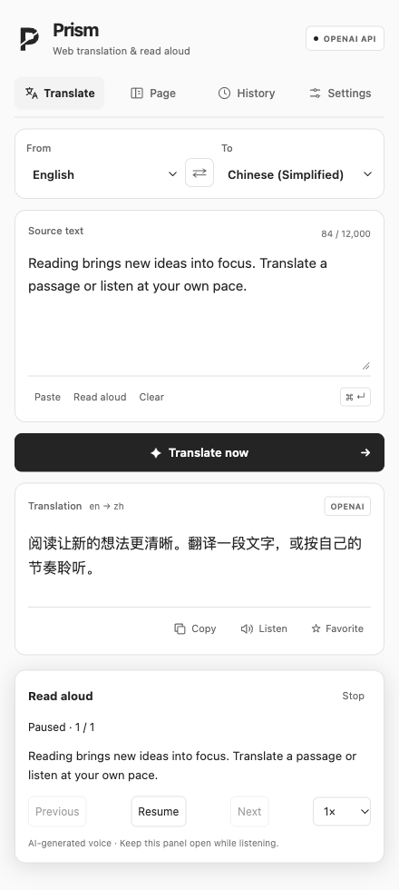

# Prism

**English** | [简体中文](README.zh-CN.md)

Prism is a Chrome extension for web translation and AI read aloud. Select text to translate or listen, view a page in two languages, or listen to an article while keeping the source in view. A compact selection menu and a circular button in the bottom-right corner keep these actions close to what you are reading. The side panel remains available for settings, history, and typed text.

Translation supports Chrome's on-device models, OpenAI, Kimi, and MyMemory. Read aloud uses OpenAI with selectable models, voices, and playback speed, sharing the endpoint and API key configured for OpenAI translation.

## Interface Preview



> Rendered from the current interface with sample text and simulated extension/model responses. The preview contains no personal account data or live API credentials; it does not demonstrate real model quality.

## Features

- **Selection menu:** translate or read selected text directly from the floating Prism menu, with light and dark styles. Translations appear beside the selection automatically and can be collapsed into the circular button.
- **Page translation:** show the original alongside its translation, switch to translation-only mode, or restore the original page.
- **AI read aloud:** listen to selected passages, article text, input text, translations, or individual words. Choose a model, voice, and speed; pause, resume, move between clips, or stop.
- **Continuous reading:** prepare upcoming audio while preserving paragraph boundaries, and highlight the source paragraph belonging to the current clip.
- **English pronunciation:** look up US IPA offline, then use the configured OpenAI service to hear the word.
- **Circular page controls:** page translation and reading start with a small button in the bottom-right corner showing progress and status in its ring. Click to expand progress, playback controls, or a selection translation you collapsed. Reading continues when collapsed. No side panel opens automatically. Each reader belongs to its source tab.
- **History and favorites:** search, save, and remove translations in the current Chrome profile.
- **Interface preferences:** English and Simplified Chinese, light and dark themes, and translation progress.

## Install and Run

Requires Chrome 116 or later. On-device translation requires desktop Chrome 138 or later and supported language packs; other translation providers are available on older supported Chrome versions.

1. Download or clone the project and keep the `x-prism` directory on your computer.
2. Open `chrome://extensions` and enable **Developer mode**.
3. Choose **Load unpacked** and select the project directory containing `manifest.json`.
4. Open an ordinary web page and click the Prism toolbar icon.
5. Choose a translation provider in **Settings** and save your configuration.

After updating the source, reload the extension in `chrome://extensions` and refresh any web pages using its previous content script. Chrome internal pages and the Chrome Web Store do not allow these page features.

## Quick Start

| Task | Action |
| --- | --- |
| Translate a passage | Select text → Prism menu → **Translate** |
| Listen to a passage | Select text → Prism menu → **Read aloud** |
| Look up and hear a word | Translate an English word → view its IPA → **Read word** |
| Read a bilingual page | Right-click the page → **Translate this page** |
| Listen to an article | Right-click the page → **Read this article aloud** |
| Translate selection or page | `Alt+Shift+T` / `⌥⇧T`: selected text when present, otherwise the page |
| Read / pause / resume | `Alt+Shift+S` / `⌥⇧S`: selected text when present, otherwise the page |
| Translate or restore the page with a shortcut | `Alt+Shift+P` / `⌥⇧P` |

Pressing Translate on an already translated page keeps the translation; use `⌥⇧P` or Restore to return to the original. During narration, pressing Read again pauses or resumes; selecting different text starts a new reading. These actions require a regular web page that permits extensions.

Open **Settings → Keyboard shortcuts** to see the keys currently assigned by your browser, then choose **Change shortcuts** to customize them. If a shortcut shows “Not assigned”, assign it on the page that opens. Changes take effect immediately without saving Prism settings.

Reading started from the selection menu or page context menu shows a circular button in the bottom-right corner; no side panel is required. Click the circle to expand playback controls, then click it again or use Collapse to return to the circle while reading continues. Use Close to stop playback. Navigating away stops that page's reader. Reading explicitly started inside the side panel still requires that panel to stay open. The reading controls apply to the current audio clip; each clip belongs to one source paragraph; longer paragraphs may span multiple clips.

## Translation Providers

| Provider | Processing | Credentials |
| --- | --- | --- |
| Chrome Local AI | On-device translation; language packs may download on first use | None |
| OpenAI · Local Codex CLI | The model service configured in the local Codex CLI | Existing Codex login |
| OpenAI · API | The configured OpenAI or compatible endpoint | Your API key |
| Kimi · Local CLI | The service used by the local Kimi Code CLI | Existing Kimi Code login |
| Kimi · Open Platform API | The selected domestic or international Moonshot API | Your API key for that region |
| MyMemory | MyMemory's online translation service | None |

When the detected source and selected target language match, Prism switches the target between English and Chinese. Page translation skips navigation, forms, code, and hidden content. Changed page fragments are skipped, and page navigation invalidates pending results.

### OpenAI API

In **Settings → OpenAI → API**, enter the endpoint, API key, and text model. The default endpoint is `https://api.openai.com/v1/chat/completions`. Custom compatible services must support the requested model and output format.

Use **Detect connection and refresh models** to load the service's model list, or enter a model ID manually if the service does not provide one. Leave reasoning effort at the model default unless the chosen model supports an explicit value. Save your settings before translating.

Chrome asks for access to the configured origin. Remote endpoints must use HTTPS; localhost services may use HTTP. Requests omit browser cookies and reject redirects. API credentials are separate from a Codex CLI login.

### Local CLI Connectors

The optional Codex and Kimi connectors require macOS or Linux, Node.js 20+, and an installed, signed-in CLI. They use cloud model services, not offline inference. Windows installation scripts are not provided.

Select the provider's **Local CLI** mode in Settings. Copy the setup command shown there, including your extension ID, and run it from the project directory:

```bash
node scripts/install-codex-host.mjs <extension-id>
# Or, for Kimi:
node scripts/install-kimi-host.mjs <extension-id>
```

Detect the connection, choose a model, and save. CLI and API model settings are stored separately. The connectors use Chrome Native Messaging, allow only the registered extension ID, and do not open a local TCP server or copy login credentials. Translation runs in isolated temporary sessions with tools disabled.

Installers target Google Chrome by default. An alternative Chromium browser's NativeMessagingHosts directory can be supplied as the second argument. `PRISM_CODEX_BIN` and `PRISM_KIMI_BIN` can point to custom CLI executables. Reinstall the connector after moving the project directory. If Codex is signed out, run `codex login` before detecting it again.

### Kimi Open Platform API

Choose **Settings → Kimi → Open Platform API**, select the domestic or international region, and enter that region's API key. Detect or enter a model, choose supported thinking options, and save. This API key and its billing are independent of the Kimi Code subscription.

## OpenAI Read Aloud

1. Configure the endpoint and key in **OpenAI → API** translation settings.
2. Under **OpenAI · Read aloud**, choose a model, voice, and playback speed.
3. Preview the voice, then save. Preview uses the current draft; page reading uses saved settings.

There is no second API key to enter. Translation can still use a different provider, but reading requires the shared OpenAI API connection even when translation runs locally. A Codex CLI login does not replace an API key.

The current model selector includes `gpt-audio-1.5`, `gpt-realtime-2.1`, and `gpt-realtime-2.1-mini`. Available voices follow the selected model; access depends on your account. Chat audio uses the exact configured endpoint. Realtime currently requires the standard OpenAI endpoint and never forwards custom-service credentials to OpenAI.

Each source paragraph is synthesized separately; adjacent short paragraphs are not combined. The opening clip is kept shorter; later clips are longer. The player targets an estimated 25-second buffer, allows at most two synthesis requests at once, and retains no more than four future clips plus the current clip. Pausing stops further prefetching; stopping cancels outstanding requests. Each clip must finish generating before playback starts.

Each request carries a fixed reading script. Before playback, Prism compares the model-reported audio transcript with that script and rejects missing or mismatched content. Formatting differences are tolerated, but numbers or symbols rewritten as words can still be rejected. This is not an independent acoustic check. Generated pronunciation may differ from the displayed dictionary IPA, especially for words with multiple readings.

Article extraction varies by website and skips navigation, forms, hidden content, and duplicate translations. Audio is AI-generated, and reading or previewing a voice incurs API usage. Account access, latency, and voice quality require verification with your actual service.

## Privacy

- No bundled API keys, analytics, advertising, or remote UI scripts.
- API keys and translation history stay in local extension storage; keys are excluded from Chrome Sync.
- Cloud translation and read aloud send the requested text to the configured service. Local translation does not make reading offline.
- Audio remains in player memory and is not saved to translation history or a persistent cache.

See [Privacy notes](PRIVACY.md) for service destinations, permissions, connectors, and removal instructions.

## Development

The extension has no build step or runtime package dependencies. Reload it after changing source files.

```bash
npm run check
```

For browser checks, serve the project locally and open `tests/content-runtime-browser.html`. The fixture loads the actual content script with simulated Chrome APIs. `demo/test-page.html` provides sample content for manual translation and reading checks. These fixtures do not replace end-to-end testing with an installed extension and a real model service.

The logo source is `assets/icon.svg`. On macOS, regenerate its PNG sizes with:

```bash
swift scripts/render_icons.swift
```

## Third-party Assets

US English IPA comes from the bundled [ipa-dict](https://github.com/open-dict-data/ipa-dict) dataset, based on CMU data. Lookup stays offline; British IPA and context-based pronunciation selection are not provided. Dataset metadata and its license are in [assets/dictionaries](assets/dictionaries).

Interface language icons are derived from [Lucide Languages](https://lucide.dev/icons/languages); its ISC license is included in [assets/LICENSE-lucide.txt](assets/LICENSE-lucide.txt). The current Prism mark is the monochrome folded P.

Older screenshots and release notes are kept in the [historical archive (Chinese)](docs/history.zh-CN.md).
