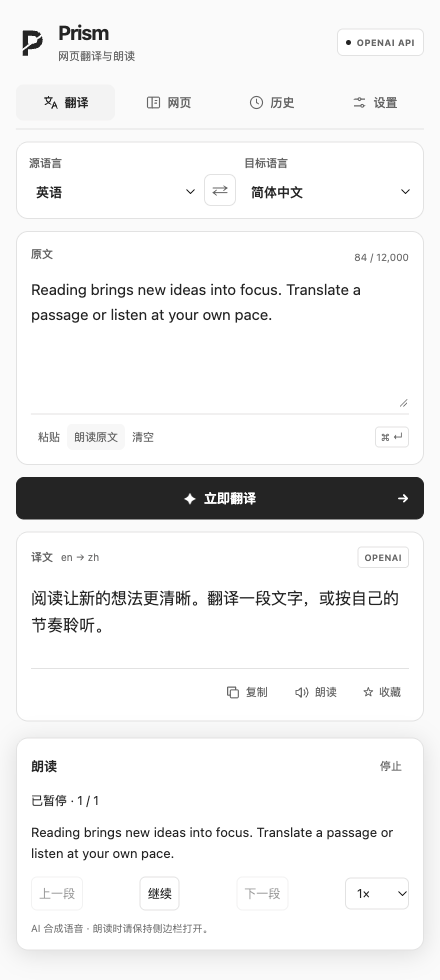

# Prism

[English](README.md) | **简体中文**

Prism 是一款支持网页翻译与 AI 朗读的 Chrome 扩展。选中文字即可翻译或朗读，也可以将整页转为双语对照，一边查看原文，一边听文章。轻量划词菜单和右下角圆形悬浮按钮让这些操作靠近正在阅读的内容。侧边栏保留设置和手动输入功能。

翻译支持 Chrome 本地模型、OpenAI 和 Kimi。朗读使用 OpenAI，可选择模型、音色和播放速度，与 OpenAI 翻译共用 API Key。

## 界面预览



> 截图使用当前界面、示例文字及模拟的扩展和模型响应生成，不包含个人账号数据或真实 API 凭据，也不代表真实模型效果。

## 功能

- **划词菜单**：选中文字后直接翻译或朗读，译文自动显示在选区附近，也可主动收起到圆形按钮。带有 Prism 标识，适配浅深色背景。
- **整页翻译**：支持原文与译文对照、仅看译文，以及恢复原始页面。
- **AI 朗读**：支持选中段落、文章正文、输入文字、译文和单词；可选择模型、音色、语速，暂停、继续、切换片段或停止。
- **连续播放**：保留原段落边界，提前准备后续音频，并高亮当前片段对应的原文段落。
- **英语单词**：离线查询美式 IPA，使用已配置的 OpenAI 服务朗读原单词。
- **圆形悬浮按钮**：整页翻译和朗读默认在网页右下角显示一个小圆，圆环提示进度和状态；点击展开进度、播放控件或主动收起的划词译文。收起后朗读继续，无需自动展开侧边栏。每个播放器关联各自的来源页面。
- **界面偏好**：中英文切换、浅深色主题，以及翻译进度提示。

## 安装与运行

最低支持 Chrome 130。本地翻译需要桌面版 Chrome 138 或更高版本及支持的语言包；较旧的受支持版本可以使用其他翻译服务。

1. 下载或克隆项目，将 `x-prism` 目录保留在电脑上。
2. 打开 `chrome://extensions`，开启**开发者模式**。
3. 点击**加载已解压的扩展程序**，选择包含 `manifest.json` 的项目目录。
4. 打开普通网页，点击工具栏中的 Prism 图标。
5. 在**设置**中选择翻译服务，完成配置并保存。

更新源码后，在 `chrome://extensions` 中重新加载扩展，并刷新仍在使用旧版脚本的网页。Chrome 内部页面和 Chrome 网上应用店不允许使用这些网页功能。

## 快速使用

| 想做什么 | 操作 |
| --- | --- |
| 翻译一段文字 | 选中文字 → Prism 菜单 → **翻译** |
| 听选中的文字 | 选中文字 → Prism 菜单 → **朗读** |
| 查音标、听单词 | 翻译英语单词 → 查看音标 → **朗读单词** |
| 查看双语网页 | 在网页空白处右键 → **翻译此网页** |
| 听整篇文章 | 在网页空白处右键 → **朗读整篇文章** |
| 翻译选区或网页 | `Alt+Shift+T` / `⌥⇧T`：有选区翻译选中文字，无选区翻译网页 |
| 朗读 / 暂停 / 继续 | `Alt+Shift+S` / `⌥⇧S`：有选区朗读选中文字，无选区朗读网页 |
| 快捷翻译或恢复网页 | `Alt+Shift+P` / `⌥⇧P` |

网页已经翻译时再次按翻译快捷键会保留译文，恢复原文仍使用 `⌥⇧P` 或恢复按钮。朗读过程中再次按朗读快捷键可暂停或继续；选择不同的文字后按下则开始新的朗读。这些操作需在允许扩展运行的普通网页上使用。

在 **设置 → 键盘快捷键** 查看浏览器当前分配的按键，点击 **修改快捷键** 自定义。若显示“未设置”，可在打开的页面分配按键；修改后立即生效，无需在 Prism 中保存。

从划词菜单或网页右键菜单发起的朗读默认显示为右下角圆形按钮，无需展开侧边栏。点击圆形按钮展开播放控件，再次点击或按收起按钮恢复为小圆，朗读继续；点关闭停止播放，页面跳转后朗读也会停止。主动在侧边栏内发起的朗读仍需保持侧边栏打开。播放控件按音频片段切换，每个片段只对应一个原段落，较长段落可能分成多个片段。

## 翻译服务

| 服务 | 处理方式 | 凭据 |
| --- | --- | --- |
| Chrome Local AI | 在设备内翻译；首次使用可能下载语言包 | 无 |
| OpenAI · API | 固定使用 OpenAI 官方 Responses 接口（`https://api.openai.com/v1/responses`） | 用户自己的 OpenAI API Key |
| Kimi · 开放平台 API | 使用所选国内或国际 Moonshot 接口 | 对应区域的 API Key |
| Kimi · Code 订阅 API | 使用所选国内或国际 Kimi Code 订阅接口 | 对应区域的订阅 Key |

源语言与目标语言相同时，Prism 会在中文和英文之间切换目标语言。整页翻译会跳过导航、表单、代码和隐藏内容；已经变化的片段会被跳过，网页跳转后旧请求结果不再写入。

### OpenAI API

在**设置 → OpenAI**中填写官方 API Key 和文本模型。标准、Fast 和 Ultrafast 档位均固定使用官方地址 `https://api.openai.com/v1/responses`。

点击**检测连接并刷新模型**读取账号可用的 Responses API 文本模型，也可以手动填写模型 ID。除非模型支持明确指定推理强度，否则保持默认选项。翻译前先保存设置。

Chrome 会请求访问 `https://api.openai.com/*` 权限。请求不携带浏览器 Cookie，并拒绝重定向。

**服务档位**仅用于 OpenAI API 翻译，与推理强度独立。默认使用标准档位，升级后保留已有 Fast 设置。Fast 费用更高，需模型支持。[OpenAI Fast 定价表](https://developers.openai.com/api/docs/pricing#fast-pricing-data)

**Ultrafast** 费用高于 Fast，适用于 `gpt-6.2-astra`、`gpt-6.2-sol`、`gpt-6-astra` 和 `gpt-6.1-sol`。实际可用性取决于 API 项目和服务限额。[OpenAI Ultrafast 指南](https://developers.openai.com/api/docs/guides/ultrafast-mode)

### Kimi 开放平台 API

选择**设置 → Kimi → 开放平台 API**，选择国内或国际区域，填写该区域的 API Key。检测或手动填写模型，选择受支持的思考选项并保存。开放平台 Key 及其计费与 Kimi Code 订阅独立。

## OpenAI 朗读

1. 在翻译的 **OpenAI** 设置中填写官方 API Key。
2. 到 **OpenAI · 朗读设置**选择模型、音色和播放速度。
3. 试听后保存。试听使用当前草稿，网页朗读使用已保存的配置。

无需再填第二份 Key。翻译可以继续使用其他服务，但即使翻译在本地运行，朗读仍需要共用的 OpenAI 官方 API Key。

当前模型选项包括 `gpt-realtime-2.1` 和 `gpt-realtime-2.1-mini`，使用 OpenAI 官方 Realtime API（短时效 `client_secrets` + WebSocket）。可用音色随模型匹配，实际访问权限取决于账号。

每个原段落独立合成，相邻短段落不会合并。首片较短，后续片段适当加长。播放器以约 25 秒的预计播放时长为缓冲目标，最多同时发起 2 个合成请求，保留当前片及最多 4 个后续片段。暂停后不再扩充缓冲，停止会取消未完成请求；每片完整生成后才开始播放。

每次请求都明确指定朗读原文。播放前会核对模型返回的音频转写，缺失或不匹配时不播放。排版差异可以忽略，但数字、符号被改写成词语时仍可能被拦截；这不等同于独立听音校验。模型发音也可能与词典音标不同，尤其是多音词。

正文提取效果因网站而异，会跳过导航、表单、隐藏内容和重复译文。声音由 AI 合成，朗读和试听都会产生 API 用量；账号权限、生成延迟和听感需要使用实际服务确认。

## 隐私

- 不内置 API Key、分析埋点、广告或远程界面脚本。
- 密钥仅保存在扩展本地存储中且不参与 Chrome Sync；译文与原文不保存本地历史记录。
- 云端翻译和朗读会将所需文字发送到配置的服务。本地翻译不代表朗读也离线。
- 音频仅保留在播放器内存中，不写入翻译历史或持久缓存。

服务地址、权限、连接器及卸载方式详见[隐私说明（英文）](PRIVACY.md)。

## 开发

扩展无需构建，也没有运行时包依赖。修改源码后重新加载扩展即可。

```bash
npm run check
```

通过本地 HTTP 服务打开 `tests/content-runtime-browser.html`，可以运行浏览器检查。该页面加载真实内容脚本并模拟 Chrome API；`demo/test-page.html` 提供手动检查翻译与朗读的示例文字。这些检查不能代替已安装扩展与真实模型服务的端到端验证。

图标源文件为 `assets/icon.svg`。在 macOS 上重新生成 PNG：

```bash
swift scripts/render_icons.swift
```

## 第三方资源

美式英语 IPA 来自随扩展打包的 [ipa-dict](https://github.com/open-dict-data/ipa-dict) 词典，基于 CMU 数据。查询离线完成；目前不提供英式音标，也不会根据上下文选择多音词读法。数据版本和许可证保留在 [assets/dictionaries](assets/dictionaries) 中。

界面语言图标改编自 [Lucide Languages](https://lucide.dev/icons/languages)，ISC 许可证保留在 [assets/LICENSE-lucide.txt](assets/LICENSE-lucide.txt)。当前 Prism 标识为单色「折光 P」。

旧版截图和更新记录保留在[历史归档](docs/history.zh-CN.md)中。

### Kimi Code 订阅 API

选择 **设置 → Kimi → Kimi Code 订阅 API**，选择区域并填写对应的订阅 Key，检测或手动填写模型后保存。订阅与开放平台的配置、Key 分别保存。国内使用 `https://api.kimi.com/coding/v1`，国际使用 `https://api.kimi.ai/coding/v1`。订阅权益面向编程场景，实际可用性取决于账号权益和客户端支持，详见[官方文档](https://www.kimi.com/code/docs/)。
