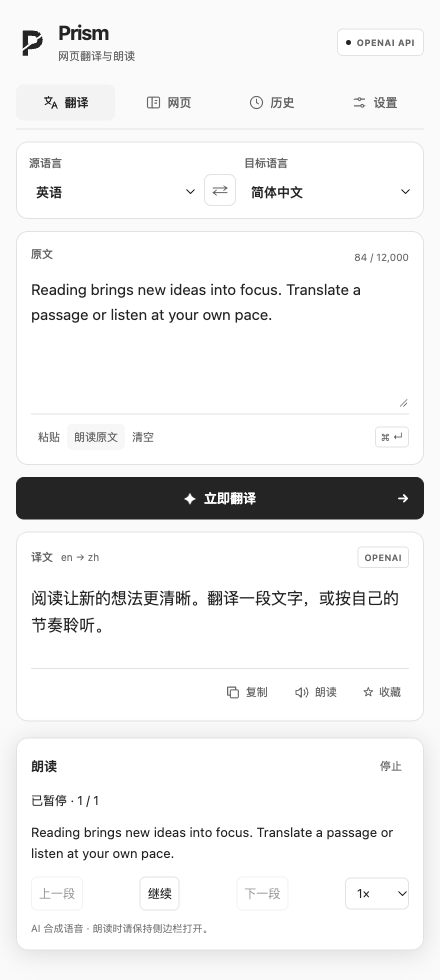

# Prism

[English](README.md) | **简体中文**

Prism 是一款支持网页翻译与 AI 朗读的 Chrome 扩展。选中文字即可翻译或朗读，也可以将整页转为双语对照，一边查看原文，一边听文章。轻量划词菜单和 Chrome 原生侧边栏，让这些操作始终靠近正在阅读的内容。

翻译支持 Chrome 本地模型、OpenAI、Kimi 和 MyMemory。朗读使用 OpenAI，可选择模型、音色和播放速度，直接共用 OpenAI 翻译的接口地址和 API Key。

## 界面预览



> 截图使用当前界面、示例文字及模拟的扩展和模型响应生成，不包含个人账号数据或真实 API 凭据，也不代表真实模型效果。

## 功能

- **划词菜单**：选中文字后直接翻译或朗读，带有 Prism 标识，适配浅深色背景。
- **整页翻译**：支持原文与译文对照、仅看译文，以及恢复原始页面。
- **AI 朗读**：支持选中段落、文章正文、输入文字、译文和单词；可选择模型、音色、语速，暂停、继续、切换片段或停止。
- **连续播放**：保留原段落边界，提前准备后续音频，并高亮当前片段对应的原文段落。
- **英语单词**：离线查询美式 IPA，使用已配置的 OpenAI 服务朗读原单词。
- **独立侧边栏**：每个标签页分别打开，翻译和朗读关联各自的来源页面。
- **历史与收藏**：在当前 Chrome 资料中搜索、收藏和删除译文。
- **界面偏好**：中英文切换、浅深色主题，以及翻译进度提示。

## 安装与运行

最低支持 Chrome 116。本地翻译需要桌面版 Chrome 138 或更高版本及支持的语言包；较旧的受支持版本可以使用其他翻译服务。

1. 下载或克隆项目，将 `x-prism` 目录保留在电脑上。
2. 打开 `chrome://extensions`，开启**开发者模式**。
3. 点击**加载已解压的扩展程序**，选择包含 `manifest.json` 的项目目录。
4. 打开普通网页，点击工具栏中的 Prism 图标。
5. 在**设置**中选择翻译服务，完成配置并保存。

更新源码后，在 `chrome://extensions` 中重新加载扩展，并刷新仍在使用旧版脚本的网页。Chrome 内部页面和 Chrome 网上应用店不允许使用这些网页功能。

## 快速使用

| 想做什么 | 操作 |
| --- | --- |
| 翻译一段文字 | 选中文字 → Prism 菜单 → **翻译** |
| 听选中的文字 | 选中文字 → Prism 菜单 → **朗读** |
| 查音标、听单词 | 翻译英语单词 → 查看音标 → **朗读单词** |
| 查看双语网页 | 侧边栏 → **网页** → 选择双语模式并翻译 |
| 听整篇文章 | 侧边栏 → **网页** → **朗读整篇文章** |
| 快捷翻译选区 | `Alt+Shift+T` / `⌥⇧T` |
| 快捷翻译或恢复网页 | `Alt+Shift+P` / `⌥⇧P` |

播放时需保持侧边栏打开。播放控件按音频片段切换，每个片段只对应一个原段落，较长段落可能分成多个片段。

## 翻译服务

| 服务 | 处理方式 | 凭据 |
| --- | --- | --- |
| Chrome Local AI | 在设备内翻译；首次使用可能下载语言包 | 无 |
| OpenAI · 本机 Codex CLI | 使用本机 Codex 配置的模型服务 | 已有 Codex 登录 |
| OpenAI · API | 使用配置的 OpenAI 或兼容接口 | 用户自己的 API Key |
| Kimi · 本机 CLI | 使用本机 Kimi Code 的模型服务 | 已有 Kimi Code 登录 |
| Kimi · 开放平台 API | 使用所选国内或国际 Moonshot 接口 | 对应区域的 API Key |
| MyMemory | MyMemory 在线翻译服务 | 无 |

源语言与目标语言相同时，Prism 会在中文和英文之间切换目标语言。整页翻译会跳过导航、表单、代码和隐藏内容；已经变化的片段会被跳过，网页跳转后旧请求结果不再写入。

### OpenAI API

在**设置 → OpenAI → API**中填写接口地址、API Key 和文本模型。默认地址为 `https://api.openai.com/v1/chat/completions`；自定义兼容服务需要支持所选模型及所需的输出格式。

点击**检测连接并刷新模型**读取服务提供的模型列表；服务不支持模型列表时，也可以手动填写模型 ID。除非模型支持明确指定推理强度，否则保持默认选项。翻译前先保存设置。

Chrome 会请求访问所配置域名的权限。远程接口必须使用 HTTPS，本机服务可使用 HTTP。请求不携带浏览器 Cookie，并拒绝重定向。API 凭据与 Codex CLI 登录独立。

### 本机 CLI 连接器

可选的 Codex 和 Kimi 连接器需要 macOS 或 Linux、Node.js 20+，以及已安装并登录的 CLI。它们使用云端模型服务，不是离线推理；目前没有 Windows 安装脚本。

在设置中选择对应服务的**本机 CLI**模式，复制页面提供的安装命令及实际扩展 ID，在项目目录运行：

```bash
node scripts/install-codex-host.mjs <扩展ID>
# 使用 Kimi 时运行：
node scripts/install-kimi-host.mjs <扩展ID>
```

检测连接、选择模型并保存。CLI 与 API 模式分别保存模型配置。连接器通过 Chrome Native Messaging 工作，仅允许已注册的扩展 ID 连接，不监听本地 TCP 端口，也不复制登录凭据。翻译在关闭工具能力的独立临时会话中进行。

安装脚本默认注册到 Google Chrome；其他 Chromium 浏览器可将 NativeMessagingHosts 目录作为第二个参数传入。`PRISM_CODEX_BIN` 和 `PRISM_KIMI_BIN` 可指定 CLI 可执行文件。移动项目目录后需要重新安装连接器。如果 Codex 尚未登录，先运行 `codex login`，再检测连接。

### Kimi 开放平台 API

选择**设置 → Kimi → 开放平台 API**，选择国内或国际区域，填写该区域的 API Key。检测或手动填写模型，选择受支持的思考选项并保存。开放平台 Key 及其计费与 Kimi Code 订阅独立。

## OpenAI 朗读

1. 在翻译的 **OpenAI → API** 设置中填写接口地址和 Key。
2. 到 **OpenAI · 朗读设置**选择模型、音色和播放速度。
3. 试听后保存。试听使用当前草稿，网页朗读使用已保存的配置。

无需再填第二份 Key。翻译可以继续使用其他服务，但即使翻译在本地运行，朗读仍需要共用的 OpenAI API 连接。Codex CLI 登录不能代替 API Key。

当前模型选项包括 `gpt-audio-1.5`、`gpt-realtime-2.1` 和 `gpt-realtime-2.1-mini`，音色随模型匹配，实际访问权限取决于账号。Chat 音频使用所配置的完整接口地址；Realtime 当前要求标准 OpenAI 官方接口，不会把自定义服务的凭据转发给 OpenAI。

每个原段落独立合成，相邻短段落不会合并。首片较短，后续片段适当加长。播放器以约 25 秒的预计播放时长为缓冲目标，最多同时发起 2 个合成请求，保留当前片及最多 4 个后续片段。暂停后不再扩充缓冲，停止会取消未完成请求；每片完整生成后才开始播放。

每次请求都明确指定朗读原文。播放前会核对模型返回的音频转写，缺失或不匹配时不播放。排版差异可以忽略，但数字、符号被改写成词语时仍可能被拦截；这不等同于独立听音校验。模型发音也可能与词典音标不同，尤其是多音词。

正文提取效果因网站而异，会跳过导航、表单、隐藏内容和重复译文。声音由 AI 合成，朗读和试听都会产生 API 用量；账号权限、生成延迟和听感需要使用实际服务确认。

## 隐私

- 不内置 API Key、分析埋点、广告或远程界面脚本。
- 密钥和翻译历史保存在扩展本地存储中；密钥不参与 Chrome Sync。
- 云端翻译和朗读会将所需文字发送到配置的服务。本地翻译不代表朗读也离线。
- 音频仅保留在侧边栏内存中，不写入翻译历史或持久缓存。

服务地址、权限、连接器及卸载方式详见[隐私说明（英文）](PRIVACY.md)。

## 开发

扩展无需构建，也没有运行时包依赖。修改源码后重新加载扩展即可。

```bash
npm run check
```

通过本地 HTTP 服务打开 `tests/content-runtime-browser.html`，可以运行浏览器检查。该页面加载真实内容脚本并模拟 Chrome API；`demo/test-page.html` 提供手动检查翻译与朗读的示例文字。这些检查不能代替已安装扩展与真实模型服务的端到端验证。

图标源文件为 `assets/icon.svg`。在 macOS 上重新生成 PNG：

```bash
swift scripts/render_icons.swift
```

## 第三方资源

美式英语 IPA 来自随扩展打包的 [ipa-dict](https://github.com/open-dict-data/ipa-dict) 词典，基于 CMU 数据。查询离线完成；目前不提供英式音标，也不会根据上下文选择多音词读法。数据版本和许可证保留在 [assets/dictionaries](assets/dictionaries) 中。

界面语言图标改编自 [Lucide Languages](https://lucide.dev/icons/languages)，ISC 许可证保留在 [assets/LICENSE-lucide.txt](assets/LICENSE-lucide.txt)。当前 Prism 标识为单色「折光 P」。

旧版截图和更新记录保留在[历史归档](docs/history.zh-CN.md)中。
